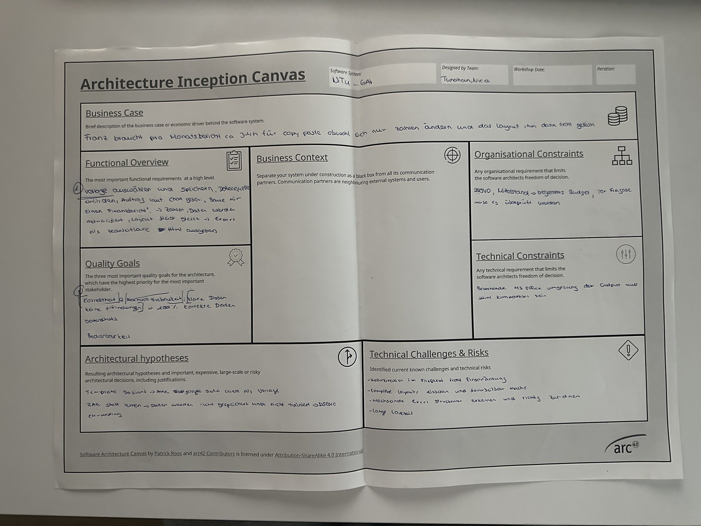
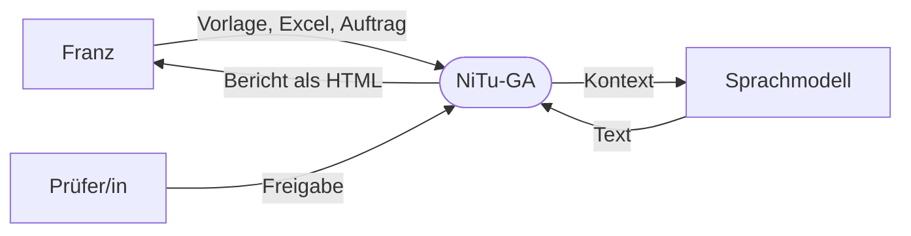

# Architecture Inception Canvas

**1 Business Case:** Franz braucht 3–4 h pro Monatsbericht für Copy-Paste, obwohl sich nur die Zahlen ändern.

**2 Functional Overview:** Vorlage speichern → Excel-Datei anfügen → Auftrag per Chat → Zahlen werden aktualisiert, Layout bleibt → Export als HTML

**3 Quality Goals**

| Ziel | Szenario (Stimulus → Response) | Messgröße |
|---|---|---|
| Korrektheit | Franz lässt den Bericht erstellen → jede Zahl kommt aus der Excel-Datei und hat eine Quellenangabe | 100 % korrekte Zahlen, 0 erfundene |
| Datenschutz | Franz lädt Finanzdaten hoch → Verarbeitung nur im Unternehmen bzw. in der EU | 0 Daten nach außen |
| Bedienbarkeit | Franz nutzt das Tool zum ersten Mal → Bericht ohne Schulung | ≤ 10 min |

**4 Business Context**

**5 Org. Constraints:** DSGVO, kleines Budget, Bericht muss vor Versand geprüft werden.

**6 Tech. Constraints:** MS-Office-Umgebung beim Kunden, Ausgabe als HTML.

**7 Hypotheses:** siehe [ADRs](../architecture/README.md).

**8 Risks:** Sprachmodell erfindet Zahlen (#4), Excel-Aufbau ändert sich jeden Monat (#5), komplexe Layouts, lange Laufzeit.

**Issue-Kandidaten:** #2 Business Context, #3 Quality Goals messbar, #4 Halluzination, #5 Excel-Strukturen, #6 Persona-Pfeile
