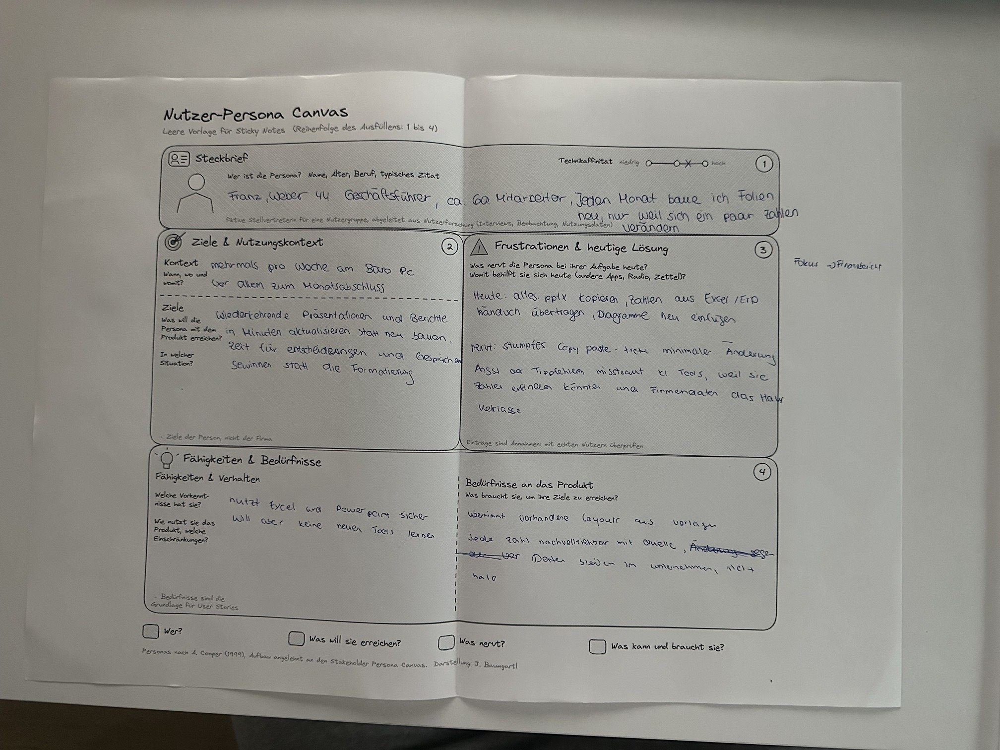

# Persona: Franz Weber

| Feld | Inhalt |
|---|---|
| **Steckbrief** | 44, Geschäftsführer (ca. 60 Mitarbeiter), Technikaffinität mittel bis hoch. „Jeden Monat baue ich Folien neu, nur weil sich ein paar Zahlen verändern.“ |
| **Ziele & Kontext** | Am Büro-PC zum Monatsabschluss. Will Berichte in Minuten statt Stunden aktualisieren. Erfolg: Bericht in ≤ 10 min statt 3–4 h. |
| **Frustrationen** | Alte .pptx kopieren und Zahlen von Hand übertragen. Angst vor Tippfehlern. Misstraut KI (erfundene Zahlen, Daten verlassen die Firma). |
| **Fähigkeiten & Bedürfnisse** | Kann Excel und PowerPoint, will keine neuen Tools lernen. Braucht: eigenes Layout bleibt, jede Zahl mit Quelle, Daten bleiben im Unternehmen. |

**Pfeile:** „Zahl mit Quelle“ *löst* „Misstrauen gegenüber KI“ · „Keine neuen Tools lernen“ *gefährdet* „Bericht in Minuten“
