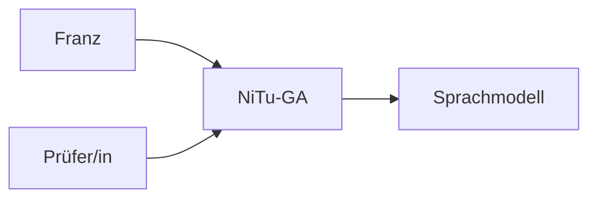
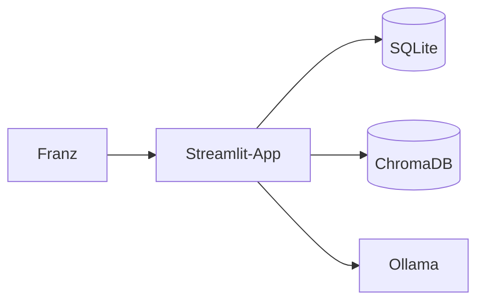

# Architektur

## ADRs

- [ADR-001](adr/ADR-001-template-basierte-berichtserstellung.md) Bericht aus Vorlage
- [ADR-002](adr/ADR-002-rag-statt-training.md) RAG statt Training
- [ADR-003](adr/ADR-003-betrieb-im-unternehmen-oder-eu-hosting.md) Lokaler Betrieb
- [ADR-004](adr/ADR-004-technologie-stack-aus-den-labs.md) Stack aus den Labs

## C4 System Context

## C4 Container

