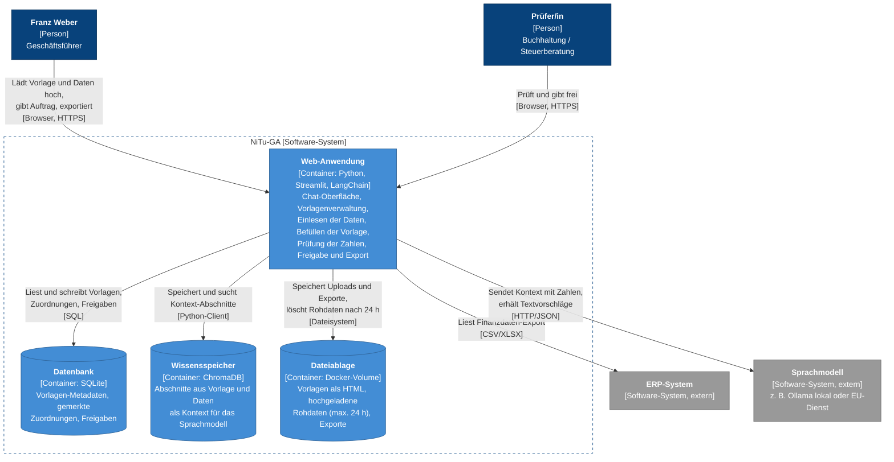

# Ebene 2: Container – NiTu-GA

**Frage, die das Diagramm beantwortet:** Aus welchen lauffähigen Bausteinen besteht NiTu-GA, und wie arbeiten sie zusammen?
Technologien nach [ADR-004](../adr/ADR-004-technologie-stack-aus-den-labs.md), Betrieb nach [ADR-003](../adr/ADR-003-betrieb-im-unternehmen-oder-eu-hosting.md).

**Legende:** dunkelblau = Person · hellblau = Container von NiTu-GA · Zylinder = Datenspeicher · grau = externes System · gestrichelter Rahmen = Systemgrenze · Pfeil = Beziehung (Absicht [Technologie])

## Container

| Container | Technologie | Aufgabe | Bezug |
|---|---|---|---|
| Web-Anwendung | Python, Streamlit, LangChain, pandas, Jinja2, plotly | Oberfläche und gesamte Logik: Vorlagen verwalten, Excel/CSV einlesen, Werte deterministisch zuordnen und berechnen, Sprachmodell für Text anfragen, Zahlen im Text prüfen, HTML erzeugen | E1–E4, ADR-001, ADR-002 |
| Datenbank | SQLite | Dauerhafte, kleine Daten: welche Vorlagen es gibt, gemerkte Spaltenzuordnungen, Freigabe-Protokoll | US 1.2, US 2.2, US 4.1 |
| Wissensspeicher | ChromaDB | Durchsuchbare Abschnitte als Kontext für Formulierungen (RAG), keine Rohdaten über das Auftragsende hinaus | ADR-002, US 4.3 |
| Dateiablage | Docker-Volume | Vorlagen-HTML dauerhaft; Rohdaten nur bis 24 h nach Auftragsende; exportierte Berichte | US 1.1, US 4.2, US 4.3 |

## Hinweise

- Oberfläche und Logik liegen bewusst in **einem** Container, weil Streamlit beides in einem Prozess ausführt (ADR-004).
  Wird die Logik später größer, kann sie als eigener API-Container ausgelagert werden. Das wäre dann ein neues ADR.
- Das Sprachmodell wird nicht als Container von NiTu-GA gezeigt, weil es ein austauschbares externes System ist.
  Wo es im Standardbetrieb läuft (im selben Netz), gehört in ein späteres Deployment-Diagramm.
- Das ERP-System wird im ersten Schritt nicht per Schnittstelle angebunden. Der Pfeil steht für den Export, den Franz oder die Buchhaltung bereitstellt.
