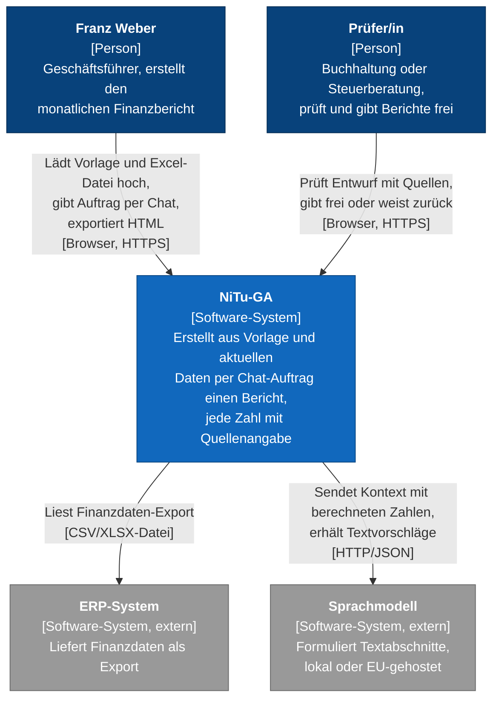

# Ebene 1: System Context – NiTu-GA

**Frage, die das Diagramm beantwortet:** Wer nutzt NiTu-GA und mit welchen anderen Systemen tauscht es Daten aus?

**Legende:** dunkelblau = Person · blau = das betrachtete System · grau = externes System · Pfeil = Beziehung (Absicht [Technologie])

## Elemente

| Element | Typ | Aufgabe |
|---|---|---|
| Franz Weber | Person | Geschäftsführer, Hauptnutzer (siehe [Persona](../../analysis/persona.md)) |
| Prüfer/in | Person | Vier-Augen-Prinzip vor dem Versand (Org. Constraint, US 4.1) |
| NiTu-GA | Software-System | KI-Berichtsgenerator für Finanz-Monatsberichte |
| ERP-System | Externes System | Quelle der Finanzdaten, exportiert CSV oder XLSX |
| Sprachmodell | Externes System | Formuliert Fließtext, schreibt aber keine Zahlen ([ADR-002](../adr/ADR-002-rag-statt-training.md)) |

## Abweichungen zum Business Context im AIC

- **Excel-Dateien** sind kein eigenes System, sondern Dateien, die Franz hochlädt. Sie stecken in der Beziehung Franz → NiTu-GA.
- **Bisherige Berichte** werden als Vorlage von Franz hochgeladen und sind deshalb ebenfalls kein Nachbarsystem.
- **MS-Office-Umgebung / Browser** tauscht keine Daten mit NiTu-GA aus. Franz öffnet das exportierte HTML dort selbst.
- Das **Sprachmodell** bleibt ein Nachbarsystem, auch wenn es im Standardbetrieb im selben Netz läuft ([ADR-003](../adr/ADR-003-betrieb-im-unternehmen-oder-eu-hosting.md)). Es ist austauschbar und wird nicht vom Team entwickelt.
